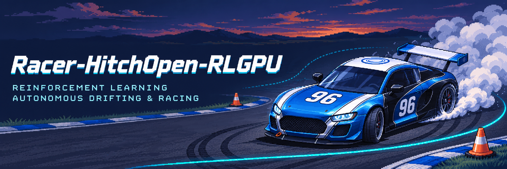
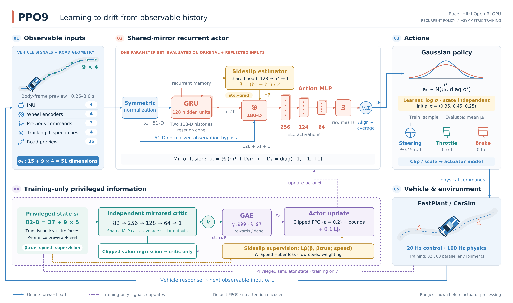
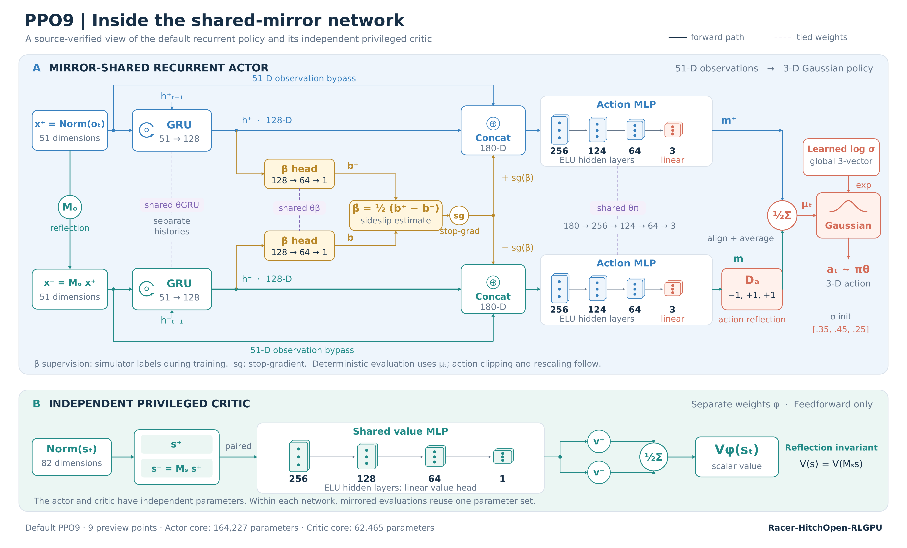

# Racer-HitchOpen-RLGPU

CarSim规模后驱电动车的持续漂移与路径跟踪。基于XCAR的GPU并行仿真和PPO范式，使用可观测actor、独立特权critic及域随机化。训练使用FastPlant，策略验收直接使用CarSim。

## 当前默认：PPO9




```powershell
python run.py train continuous_drift_iwd
# 显式覆盖示例；输出默认在仓库外 ../training_runs
python run.py train continuous_drift_iwd --seed 20261114 --epochs 200
```

默认配置集中在 [profiles/ppo9.json](profiles/ppo9.json)，命令行显式选项优先。仅continuous_drift_iwd训练自动应用PPO9；其他任务和test保持旧接口。`--profile legacy`恢复历史CLI默认，供对照实验；这不代表推荐历史训练方案。PPO7可覆盖 `--preview-time .25,.5,1,1.5,2,2.5,3`。

- 9点时间预瞄：0.25/0.5/0.75/1/1.25/1.5/2/2.5/3秒；距离由前轮平均速度确定，坐标基于车身航向。
- 真实观测旁路 + GRU128 + 256/124/64动作网络；结构镜像、低速渐隐β辅助任务、stop-gradient β反馈；独立特权critic。
- 完整动力学/传感器/执行器DR；不人为添加观测延时或丢帧，执行器动力学仍保留。
- 跟踪宽度1.5m、平滑权重0.1、uncapped速度奖励；原有随机路径分布，持续任务。
- 20Hz控制、100Hz物理；32768环境、horizon40、BPTT片段10、minibatch81920、4次mini-epochs、200 epochs。默认seed20261115，需多种子评估。
- CUDA图物理和网络更新；FP32 actor推理、既有AMP更新。物理子步/求解精度不削减。


## 安装与运行

环境依赖见 [environment.yml](environment.yml)，并行规模需按显存配置。CarSim桥接通过VehicleSim求解器API加载外部场景，使用前应配置匹配的数据库、求解器和simfile路径。

```bash
conda env create -f environment.yml
conda activate racer-env
```

CarSim路径入口见 `experiments/carsim_bridge/carsim_run.py` 与桥接环境配置；迁移机器时应更新数据库、求解器与simfile路径。

```powershell
# 明确checkpoint、匹配配置和参考路径，直接CarSim评测（无FastPlant评测队列）
python experiments/carsim_bridge/evaluate_checkpoint.py --checkpoint CHECKPOINT.pth --config ENV_CONFIG.json --reference-path PATH.npy --output EXTERNAL_OUTPUT
```

每次使用独立输出目录，保存原生CarSim结果，并备份后更新对应LastRun。不要并行启动多个CarSim写入进程。

## 结果与工程说明

200轮PPO9两个训练种子均完成29/29项120秒CarSim测试；该结果不是任意轨迹、任意初态的100%保证。中附8字漂移连续性、高速直线摆动及跨种子速度差异仍需改善。

[当前状态与结果](STATUS.md) · [性能实测](PERFORMANCE.md) · [物理模型](PLANT.md) · [数据与备份](ARTIFACTS.md)

保留PPO7/其他预瞄数、DSAC-T、奖励/网络实验及原始IWD任务接口。原始/缓存物理解法仅作为数值诊断基准；正式默认使用已验证的加速方案。实验调度与结果归档独立于核心训练接口。

## 实验接口

显式选项覆盖PPO9配置，未指定时保持默认行为：

- `--gru-hidden 64|128|256`、`--actor-units 256,124,64`：循环隐维与三层动作MLP；不同结构需从零训练。
- `--seq-length 10|20|40`：BPTT片段长度，需整除horizon；不代表实际隐状态周期性清空。
- `--road-encoder none|point_mlp|attention`：仅编码当前可观测预瞄点；attention使用相邻3点形成片段的两层32维、4头，无dropout。
- `--straight-stability-weight`、`--progress-speed-credit`、`--precision-bonus-weight`：独立奖励对照，默认0/关闭；不改变执行器硬能力。
- `--gamma`、`--tau`（GAE λ）、`--entropy-coef`、`--sigma-per-dim`：训练信用与探索设置。

checkpoint加载会重建对应循环隐维、动作MLP和道路编码器；禁止跨不兼容结构强行续训。原始观察旁路、镜像约束和独立critic保留。

## Acknowledgements

本项目基于 [XCAR / xcar-rlgpu](https://github.com/zhou-yh19/xcar-rlgpu)，感谢Yihan Zhou、Yiwen Lu及原项目团队开放GPU环境、训练框架与漂移控制研究。相关论文：[Learning to Drift with Individual Wheel Drive: Maneuvering Autonomous Vehicle at the Handling Limits](https://arxiv.org/abs/2507.23339)。保留原有授权与署名。

## Contributing

Contributions are welcome! Please feel free to submit a Pull Request.

> **Current Contributors:**
> - Komasa Qi, School of Vehicle and Mobility, THU, komasaqi@foxmail.com
> - Zhantao Wang, Digital China, wangztq@digitalchina.com
> - Yuhang Wu, College of AI, Tsinghua University, yh-wu22@mails.tsinghua.edu.cn
> - Yifan Qiu, School of Engineering, CAU, YFNXforCN@outlook.com

## License

MIT License，见 [LICENSE](LICENSE)。
