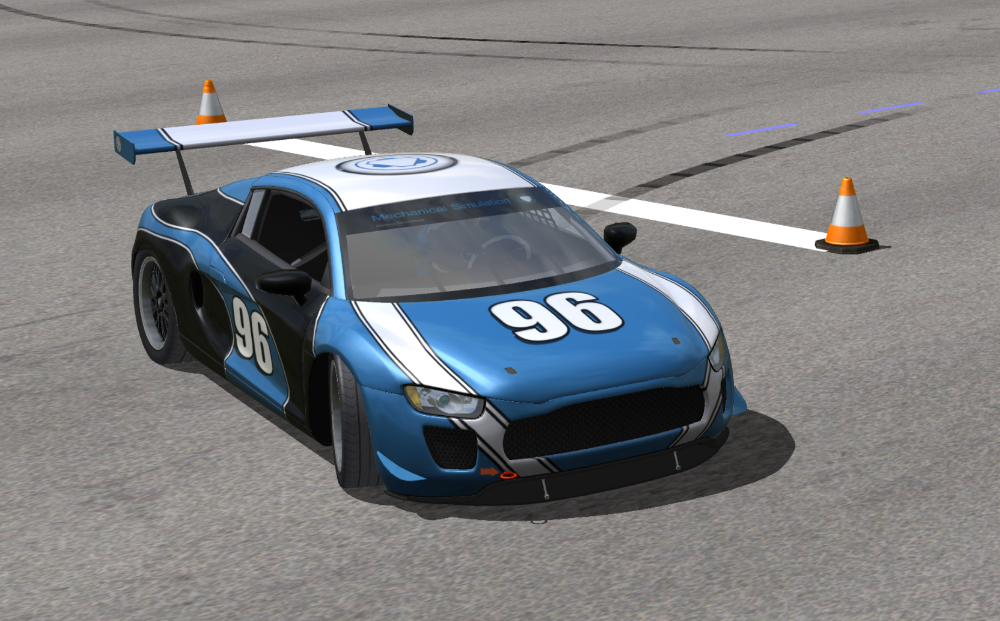
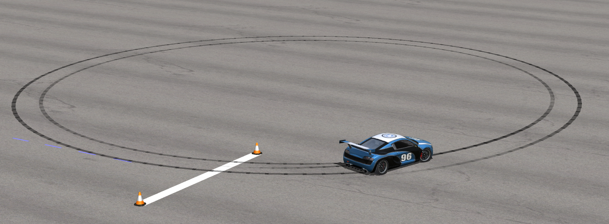
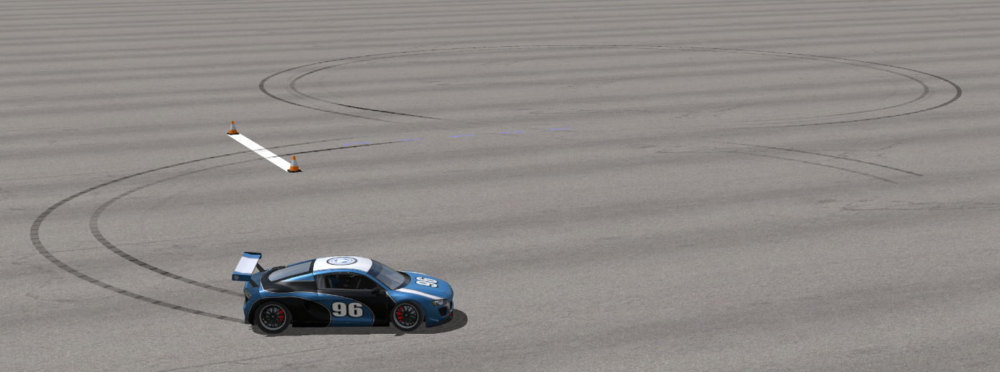

# GPU Accelerated RL Race Car for HitchOpen World AI Championship 🏎️
<div style="display: flex; gap: 10px; align-items: stretch;">
  <!-- 左侧：单张图，40% -->
  <div style="width: 60%;">
    
  </div>
  <!-- 右侧：60%，两张上下叠放，间距 -->
  <div style="width: 47%; display: flex; flex-direction: column; gap: 10px;">
    
    
  </div>
</div>


A PyTorch-based framework for training autonomous drifting policies for vehicles using reinforcement learning. This framework provides high-performance vectorized environments for drift control tasks and several baseline implementations.

[**Installation**](#installation-) | [**Quick Start**](#quick-start-) | [**Environments**](#environments-) | [**Training**](#training-) | [**Technical Details**](#technical-details-) | [**Code Structure**](#code-structure-)

## Key Features ⭐
- **High-Performance Training** - GPU-accelerated parallel simulation reduces training time from hours to minutes through vectorized environment implementations
- **Advanced Vehicle Dynamics** - Individual Wheel Drive (IWD) model enabling independent control of each wheel's speed and torque for superior maneuverability
- **Domain Randomization** - Systematic randomization of vehicle dynamics and environmental parameters to bridge the simulation-to-reality gap
- **Diverse Drift Tasks** - Comprehensive suite of drift scenarios from basic circular paths to challenging variable-curvature tracks and figure-eight patterns
- **Real-time Control** - Computationally efficient implementation suitable for embedded systems and real-world deployment
- **Comprehensive Analysis** - Extensive tools for visualizing and analyzing drift control performance across different trajectory patterns

## Installation 📂

### Requirements 🛠️
- NVIDIA GPU with CUDA support (Tested on NVIDIA RTX 3080, reduce parallel instances for lower-end GPUs)
- CUDA 11.8 or later
- PyTorch 2.0.1 or later

Create a conda environment using the provided environment.yml file:

```bash
conda env create -f environment.yml
```


## Quick Start 🚀

To run a basic training experiment with default settings:

```bash
cd experiments/continuous_drift_iwd
./run.sh
```

This trains a policy for the continuing drifting task. Runtime artifacts are written under ignored `runs/` during execution and are moved to the sibling audit/artifact directory after completion; see [ARTIFACTS.md](ARTIFACTS.md).

## Environments 🌍

We currently support several drift control environments:

| Environment | Description | Code |
|------------|-------------|------|
| Fixed Circle | Drift in a circular trajectory | [fixed_circle_iwd.py](envs/fixed_circle_iwd.py) |
| Eight-Shaped | Drift in a figure-eight pattern | [eight_drift_iwd.py](envs/eight_drift_iwd.py) |
| State Tracker | Track reference states for drifting | [state_tracker_iwd.py](envs/state_tracker_iwd.py) |
| Continuous Drift | Follow continuous drift trajectories | [continuous_drift_iwd.py](envs/continuous_drift_iwd.py) |

## Training 🎯

The default plant is `fast`: a full-size RWD EV (10 states, motor + LSD + wheel
spin, longitudinal *and* lateral load transfer, 2D aero) running at 20 Hz
control / 100 Hz physics. See [PLANT.md](PLANT.md) for the model, the presets
and the known limitations. The original XCAR IWD plant is still available with
`--plant iwd`.

```bash
# CarSim-sized RWD EV, pedals interface, 20 Hz control
python run.py train continuous_drift_iwd --car-preset fullsize_racecar_ev \
    --num-parallel 16384 --horizon 128 --gamma 0.999 --tau 0.97 \
    --plant fast --control-mode pedals --exp-name ev_pedals_v1

# check the plant before spending GPU time
cd xcar-simulation && python plant_check.py fullsize_racecar_ev
```

```bash
cd experiments/continuous_drift_iwd # Change to the experiment directory

# train the controller
./run.sh

# test the controller
python ../../run.py test continuous_drift_iwd --mlp-size-last 64 --exp-name ev_pedals_v1 --car-preset fullsize_racecar_ev --ref-mode hybrid
python plot.py --filename hybrid_ref_exp
```

Common training flags:
- `--car-preset`: Vehicle configuration (xcar, racecar, sensorcar)
- `--device`: Computing device
- `--num-parallel`: Number of parallel environments
- `--epochs`: Number of training epochs
- `--disturbed`: Enable disturbance modeling
- `--randomize-tyre`: Randomize tire parameters

The current full-size RWD-EV workflow uses domain randomization from the first formal PPO sample. `ev_drift` randomizes the calibrated vehicle, tire, LSD and powertrain parameters; sensor/actuator noise, delay and dropout are enabled separately. Hardware-specific parallel counts are not portable defaults: benchmark the GPU and keep the highest-throughput configuration with memory headroom.

## Technical Details 🔧

The project consists of several key components:

- **Core Simulation Platform** (`xcar-simulation`):
  - The PyTorch-based simulation is implemented in `gpu_vectorized_car_env.py`
  - `IWDCarDynamics`: A PyTorch module for individual wheel drive vehicle dynamics that takes current state `s`, control input `u`, and model parameters `p` as inputs and outputs state derivatives
  - `GPUVectorizedCarEnv`: A parallelized Gym environment where parameter `n` indicates the number of parallel instances; `obs`, `reward`, and `done` are PyTorch tensors with shape `(n, ?)`
  - The `step` function utilizes `IWDCarDynamics` and PyTorch's differential equation solver [torchdiffeq](https://github.com/rtqichen/torchdiffeq) to compute the next state
  - Base implementation provides raw state as `obs`, zero `reward`, and `False` for `done`, which can be overridden by specific tasks

- **Environment Implementation** (`envs`):
  - Task-specific environments inherit from `GPUVectorizedCarEnv`
  - Override `obs` and `reward` interfaces based on task requirements

- **Additional Components**:
  - `rl_games`: Reinforcement learning algorithm library (included as a submodule)
  - `utils`: Interface adaptation code
  - `run.py`: Entry point for training and testing

## Code Structure 📝

```
├── envs/                    # Environment implementations
│   ├── fixed_circle_iwd.py  # Fixed circle drifting
│   ├── eight_drift_iwd.py   # Eight-shaped drifting
│   ├── continuous_drift_iwd.py  # Continuous drifting
│   └── state_tracker_iwd.py  # State tracking for drifting
├── experiments/            # Training scripts and visualizations
│   ├── fixed_circle_iwd/
│   ├── eight_drift_iwd/
│   ├── continuous_drift_iwd/
│   └── state_tracker_iwd/
├── utils/                  # Utility functions
│   ├── generate_segment_racetrack.py
│   └── rlgame_utils.py
├── xcar-simulation/        # Core simulation components
│   ├── gpu_vectorized_car_env.py
│   ├── IWDCarDynamics.py
│   └── presets.yaml
└── run.py                  # Main training script
```

## Contributing 🤝

Contributions are welcome! Please feel free to submit a Pull Request.

> **Current Contributors:**
> - Komasa Qi, School of Vehicle and Mobility, THU, komasaqi@foxmail.com
> - Zhantao Wang, Digital China, wangztq@digitalchina.com
> - Yuhang Wu, College of AI, Tsinghua University


## License 📄

This project is licensed under the MIT License - see the LICENSE file for details.
